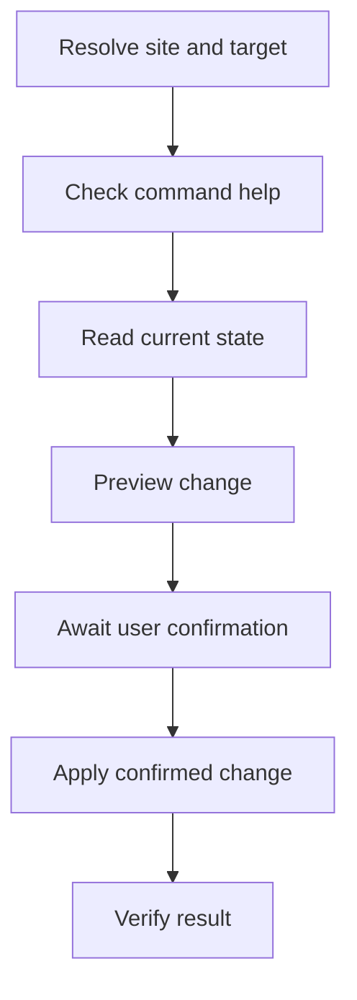

# Atlassian CLI

## Installation

If a required CLI or runtime is missing, read [installation and verification](references/installation.md).


Use the installed `acli`. Guidance was checked against local `--help` in `1.3.39-stable`. Recheck the relevant leaf command when flags or capabilities differ. Choose only commands needed for the user's goal.

## Read and write policy

- Run in-scope read-only operations without user confirmation. Keep filters, limits, and timeouts as operational safeguards.
- Before any write, mutation, or configuration change, including local edits, prepare a concrete change set. Immediately before execution, show the target, exact commands with secrets redacted, and a diff or effects summary when no text diff is available. Ask for explicit user confirmation and wait for it. The initial task request alone does not satisfy this checkpoint.
- Confirmation covers the displayed change set, including repetitive sub-steps within it. Ask again only if the target, proposed changes, or side effects change.

## Inputs

Resolve these from the request, resource URL, project context, or existing CLI authentication. Ask only when a missing fact blocks useful work.

| Input | Details |
| --- | --- |
| Site and account | Atlassian site and intended user. Issue keys and numeric IDs alone do not identify the site. |
| Target | Jira project/key, board/sprint ID, Confluence page/space/blog ID, or space key as required by the command. |
| Goal and scope | What to inspect or change, exact targets, content, and desired state. A request to investigate does not authorize publishing changes. |



For read-only work, stop after answering from the current state.

## Command selection

| Task | Command family and reference |
| --- | --- |
| Jira issues, descriptions, comments, links, boards, sprints | `acli jira workitem`, `project`, `board`, `sprint`; read [Jira](references/jira.md). Jira issues are called **work items** in ACLI. |
| Confluence pages, spaces, blogs | `acli confluence page`, `space`, `blog`; read [Confluence](references/confluence.md). |
| Authentication | `acli auth`, `acli jira auth`, `acli confluence auth`, `acli admin auth`; check leaf help. |
| Organization account changes | `acli admin user`; check leaf help. The discovered commands are `activate`, `deactivate`, `delete`, and `cancel-delete`. |
| Guard or Rovo Dev | Explore `acli guard --help` or `acli rovodev --help` only when needed. Guard delegates to separate tooling and may download it even for help. Rovo Dev help was blocked by missing authentication; its command details remain unverified. |

Help discovery:

```sh
acli --version
acli --help
acli jira workitem --help
acli jira workitem edit --help
```

Prefer the leaf's `Usage` and `Flags` over copied examples. Some installed help examples omit a command: use `acli jira workitem comment create`, not the parent `comment`; use `acli admin user deactivate`, not `acli user deactivate`.

## Authentication and execution

- Reuse existing authentication. Check the relevant product with `acli jira auth status` or `acli confluence auth status`; `acli auth status` covers shared OAuth. Verify the site/account before accessing a target.
- Site/account selection belongs to authentication, not a universal `--site` flag on resource commands. When needed within the request's scope, `acli auth switch --site example.atlassian.net --email user@example.com` switches shared OAuth. Product-specific switches also exist; inspect their help before use.
- Do not start login, switch accounts, log out, or change cloud configuration merely to explore help. If login is requested, product `auth login --web` uses OAuth; `--token` is a boolean that reads a token from stdin. Keep credentials out of arguments, output, and committed files.
- Prefer structured output with supported `--json`, selected `--fields`, filters, and bounded `--limit`. These flags are per command. Pagination differs: inspect help before combining `--limit` and `--paginate`, and report partial results.
- Use explicit flags and files in unattended runs. Avoid `--web` on resource commands, `--editor`, and unresolved interactive prompts. Use `--yes` only where supported and after explicit user confirmation of the displayed change set; it must not bypass the checkpoint.
- Preview the affected set before a JQL/filter bulk write. Prefer explicit keys for a fixed set so a changing query cannot broaden the confirmed write. Include account deletion/deactivation, project deletion, and authentication/configuration changes in the confirmation policy.
- Prefer file input for multiline content, using the leaf's actual file flag. Preserve the format expected by the command. Do not assume Markdown renders as rich content.
- Check exit status and per-item failures; avoid `--ignore-errors` unless partial success is intended. Before retrying a timed-out write, inspect current state to avoid duplicate work items, comments, links, or blog posts.
- Verify a write with a targeted read. Return the resource key/ID and URL when available, plus any access or coverage limits. Do not claim a help-only check proves live access or behavior.

`acli config gov-cloud` changes configuration by default; use `--status` for inspection. If help fails because of local config permissions or missing authentication, report that limit and resolve only what the task needs.
