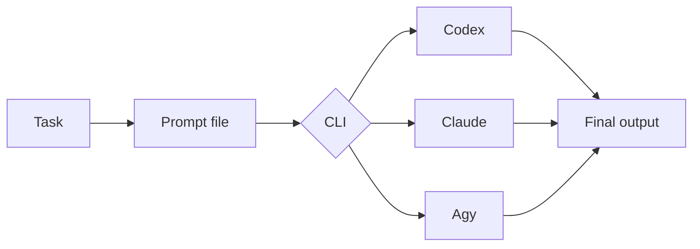

# Non-interactive harnesses

## Installation

If a required CLI or runtime is missing, read [installation and verification](references/installation.md).


This skill owns only the mechanics for running one CLI harness without a TTY. The calling workflow owns the task, prompt semantics, concurrency, retries, and stop conditions.



## Before invoking a harness

1. Verify the selected CLI with `command -v codex`, `command -v claude`, or `command -v agy`.
2. Set the working directory explicitly. Run only in a trusted repository.
3. Write the caller's full prompt to `prompt.md`.
4. Choose the least powerful mode that can finish the task.
5. Capture the final answer separately from diagnostics when the CLI supports it.

Do not interpolate untrusted text into shell options. Pass long prompts through stdin or a quoted file expansion. Redirect stdin from `/dev/null` when the prompt is already an argument so the process cannot wait for input.

## Quick choice

| Need | Codex | Claude | Agy |
|---|---|---|---|
| Analyze or review | `--sandbox read-only` | deny write and shell tools | prompt-enforced only |
| Edit workspace | `--sandbox workspace-write --approve-for-me` | `--permission-mode acceptEdits --permission-prompts none` | `--mode accept-edits --sandbox --dangerously-skip-permissions` |
| Final text only | `--output-last-message` | `--output-format text` | `--output-format text` |
| Structured result | `--output-schema` | `--json-schema` | `--json-schema` |

## Read-only task

### Codex

Codex provides an enforced read-only sandbox. `--ephemeral` avoids persisting the session.

```bash
codex exec \
  --cd /absolute/path/to/repo \
  --skip-git-repo-check \
  --sandbox read-only \
  --ephemeral \
  --output-last-message result.md \
  - < prompt.md > agent.log 2>&1
```

Read `result.md` on success. Inspect `agent.log` only when the command fails or diagnostics are needed.

### Claude

For code inspection, allow file tools but deny edits and shell execution. `--permission-prompts none` prevents an unattended run from waiting for approval.

```bash
cd /absolute/path/to/repo
claude -p \
  --disallowedTools "Edit,Write,NotebookEdit,Bash" \
  --permission-prompts none \
  --no-session-persistence \
  --output-format text \
  "$(< prompt.md)" > result.md 2> agent.log
```

Use `--tools ""` when the task needs no repository or external tools.

### Agy

Agy has no enforced read-only mode for this workflow. State `Do not edit files or run mutating commands` in the prompt. `--sandbox` limits terminal access; `--dangerously-skip-permissions` only removes approval prompts and does not make the run read-only.

```bash
cd /absolute/path/to/repo
agy --print "$(< prompt.md)" \
  --sandbox \
  --dangerously-skip-permissions \
  --output-format text > result.md 2> agent.log
```

Do not use Agy for a read-only task when prompt-only enforcement is insufficient.

## Workspace edit task

Use a clean worktree or a workspace with known user changes. Tell the agent which paths it may edit and which checks it must run.

### Codex

```bash
codex exec \
  --cd /absolute/path/to/repo \
  --sandbox workspace-write \
  --approve-for-me \
  --ephemeral \
  --output-last-message result.md \
  - < prompt.md > agent.log 2>&1
```

### Claude

```bash
cd /absolute/path/to/repo
claude -p \
  --permission-mode acceptEdits \
  --permission-prompts none \
  --no-session-persistence \
  --output-format text \
  "$(< prompt.md)" > result.md 2> agent.log
```

`acceptEdits` permits file edits. Shell commands that still need approval are denied because no user can answer. Add a narrow `--allowedTools` entry for each required check; do not allow unrestricted `Bash` by default.

### Agy

```bash
cd /absolute/path/to/repo
agy --print "$(< prompt.md)" \
  --mode accept-edits \
  --sandbox \
  --dangerously-skip-permissions \
  --output-format text > result.md 2> agent.log
```

For all three CLIs, avoid unrestricted or sandbox-bypass flags unless the caller explicitly requires them and the process already runs inside a trusted external sandbox.

## Structured output

Prefer JSON Schema when another script consumes the result. Keep the schema small and make required fields explicit.

```bash
codex exec --sandbox read-only \
  --output-schema result.schema.json \
  --output-last-message result.json \
  - < prompt.md > agent.log 2>&1

claude -p --json-schema "$(< result.schema.json)" \
  --output-format json \
  "$(< prompt.md)" > result.json 2> agent.log

agy --print "$(< prompt.md)" \
  --json-schema result.schema.json \
  --output-format json > result.json 2> agent.log
```

The JSON envelopes differ by CLI. Consumers must parse the selected CLI's documented output shape instead of assuming all three match.

## Reusable prompt envelope

The calling workflow may use this compact envelope when it has no stricter prompt contract:

```text
Goal: <one bounded outcome>
Working directory: <absolute path>
Read: <paths or areas to inspect>
May edit: <paths, or "none">
Constraints: <security, style, scope, and forbidden actions>
Checks: <commands or observable conditions>
Return: <short result format>
```

Name exact paths when known. Ask the agent to inspect relevant files before making code claims. For edit tasks, require a short list of changed files and checks run. Do not place secrets in prompts, logs, or result files.

## Reliable automation

- Check the process exit code before reading the result as success.
- Add an outer process timeout in CI. For Agy, `--print-timeout` can also bound the turn.
- Use unique scratch paths per run. Never let parallel agents share `prompt.md`, `result.md`, or `agent.log`.
- Keep stdout machine-readable. Send diagnostics to a separate log.
- Do not retry mutations blindly. Inspect the workspace first because the first run may have changed files before failing.
- Use a fresh process for independent work. Resume only when the task needs prior conversation state.
- Pin a model only when the caller requires one; otherwise use the CLI's configured default.

## Failure handling

If the CLI is missing, authentication fails, the process times out, or the result file is empty, report the failure with the CLI name and exit status. Include only the useful tail of the diagnostic log. Do not silently switch to another agent because its behavior, permissions, and output shape may differ.
