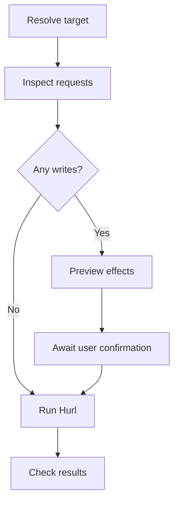

# Hurl

Use the installed `hurl`. Check `hurl --version` and `hurl --help` when flags or protocol support matter. Reuse existing `.hurl` files and project conventions.



## Read and write policy

- Run in-scope read-only operations without user confirmation. Keep filters, limits, and timeouts as operational safeguards.
- Before any write, mutation, or configuration change, including local edits, prepare a concrete change set. Immediately before execution, show the target, exact commands with secrets redacted, and a diff or effects summary when no text diff is available. Ask for explicit user confirmation and wait for it. The initial task request alone does not satisfy this checkpoint.
- Confirmation covers the displayed change set, including repetitive sub-steps within it. Ask again only if the target, proposed changes, or side effects change.

## Inputs

Resolve these from the request, environment, or project config. Ask only when a missing fact prevents useful work.

| Input | Details |
| --- | --- |
| Target | Environment, base URL, authentication, and TLS settings. Use localhost only when a local service is intended. |
| Goal | Request or flow, input data, expected status, and meaningful response checks. Inspect routes, contracts, or existing examples before choosing paths and fields. |
| Write scope | For requests with side effects: allowed target, operation, data, and cleanup if needed. Review all entries before running an existing file. |

## Usage

- Inspect every entry and its actual API effects before running a file or suite. HTTP method and `--test` do not establish read-only behavior. If any entry mutates state, preview and confirm the whole change set, including captures, follow-up requests, repeats, and cleanup, before sending requests. Include local file edits and report outputs in the checkpoint when applicable.
- Use `{{name}}` templates. Pass non-secret values with `--variable` or `--variables-file`; properties files use `name=value` lines. Prefer an existing protected `--secrets-file` for credentials. Do not put secret values in command arguments, committed files, or output. Restrict permissions and keep any new secret file outside version control.
- Write the expected status after each request, such as `HTTP 200`. Add `[Asserts]` for relevant headers and body fields. A completed transfer alone does not prove the expected API behavior. Do not use `--no-assert` to make a failing check pass.
- Use `[Captures]` to extract values for later requests in the same file. Keep dependent requests together; do not rely on captures or cookies crossing file boundaries. Cookies persist between requests by default; `--no-cookie-store` disables that behavior.
- Normal mode prints the last response body. Use `--test` for assertion summaries and CI exit status. Test mode runs files in parallel; use `--jobs 1` for files that share state. Entries inside a file run in sequence.
- Set bounded connection and transfer timeouts, for example `--connect-timeout 5 --max-time 30`. These do not bound the whole suite; use a runner deadline when needed.
- Retries and repeats can replay requests with side effects. Use finite values only when replay is safe within the task. Do not automatically retry writes, repeat flows, or enable `--continue-on-error` after a failed prerequisite.
- Keep TLS verification enabled. Use `--cacert`, `--cert`, or `--key` when required. Follow redirects only when the flow needs them; avoid `--location-trusted` unless forwarding credentials to the redirect hosts is explicitly intended.
- Start with the failing file and entry. Use `--verbose` only when needed; logs, bodies, cookies, curl exports, and reports may contain sensitive data. Redact before sharing. Use `--from-entry` and `--to-entry` only when required captures and session state are available.
- Use `hurlfmt --check` if installed to check syntax and formatting without sending requests. It does not validate the target, assertions, or runtime variables. Do not invent a Hurl dry-run flag.
- Report the target without secrets, files run, exit status, failed entry/assertion, and relevant actual versus expected values. Distinguish connection/TLS failures, HTTP errors, and assertion failures. State what was not verified.

## Examples

Adapt paths, fields, and expected values to the inspected API. Save as `order.hurl`; this example reads an order and its customer.

```hurl
GET {{base_url}}/orders/{{order_id}}
Authorization: Bearer {{token}}
HTTP 200
[Captures]
customer_id: jsonpath "$.customer_id"
[Asserts]
jsonpath "$.id" exists
jsonpath "$.customer_id" exists

GET {{base_url}}/customers/{{customer_id}}
Authorization: Bearer {{token}}
HTTP 200
[Asserts]
jsonpath "$.id" == {{customer_id}}
```

These commands assume `HURL_BASE_URL`, `ORDER_ID`, and `HURL_SECRETS_FILE` are resolved. The protected secrets file supplies `token`; the environment variable holds only its path.

```sh
# Syntax and formatting only; no HTTP requests.
hurlfmt --check order.hurl

# Run assertions with bounded request timeouts.
hurl --test --jobs 1 --no-color \
  --connect-timeout 5 --max-time 30 \
  --variable "base_url=$HURL_BASE_URL" \
  --variable "order_id=$ORDER_ID" \
  --secrets-file "$HURL_SECRETS_FILE" \
  order.hurl
```

For a suite, use a quoted `--glob 'tests/http/**/*.hurl'` pattern suited to the repo. When reports are requested, add `--report-junit artifacts/hurl.xml`, `--report-json artifacts/hurl-json`, or `--report-html artifacts/hurl-html`; keep outputs out of version control and review before sharing.

Example request: “Use staging config to run the order flow, verify its customer, and explain the first failing assertion.”

References: [manual](https://hurl.dev/docs/manual.html), [assertions](https://hurl.dev/docs/asserting-response.html), [captures](https://hurl.dev/docs/capturing-response.html), [templates](https://hurl.dev/docs/templates.html).
