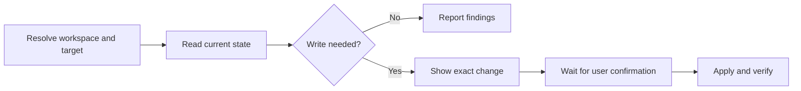

# Slack

## Installation

If a required CLI or runtime is missing, read [installation and verification](references/installation.md).


Use the installed public Slack CLI. Command syntax was checked against `v4.12.0`. Check the relevant leaf command with `--help` when flags differ or a command has not been checked in the current session. Use `slack api` for workspace interactions; the other command groups mainly manage apps.

## Read and write policy

- Run in-scope reads without confirmation. Bound searches, history, pagination, and logs to the user's goal.
- Before any Slack write, mutation, or configuration change, prepare a concrete change set. Immediately before execution, show the workspace, acting identity, exact targets, full content or diff, exact commands with secrets redacted, and effects such as notifications or deletion. Ask for explicit user confirmation and wait for their reply. The initial task request alone does not satisfy this checkpoint.
- This checkpoint covers sending, scheduling, editing, or deleting messages; replies, reactions, pins, and uploads; channel creation, membership, invitations, and archival; app installation, running, deployment, and removal; datastore writes, workflow triggers, configuration, access, and authentication changes. Prepare and review local payload files before asking; do not execute the Slack change while waiting.
- Confirmation covers only the displayed change set, including its listed sub-steps. Ask again if the workspace, identity, targets, content, or effects change. Silence, elapsed time, CLI prompts, and `--force` are not user confirmation. Do not use another tool or API to bypass this checkpoint.

## Inputs

Resolve these from the request, Slack links, project config, or existing authentication. Ask only when a missing value prevents useful work.

| Input | Details |
| --- | --- |
| Workspace and identity | Intended workspace ID and bot or user identity. Verify with `auth.test` using the actual API token. |
| Target | Channel ID, user ID, message `ts`, or thread parent `ts`; app/project and environment for app tasks. |
| Goal and scope | Search query, time range, thread, or exact change and content. Check the recipient before sending. |



## Authentication and targeting

- Start with `command -v slack` and `slack version --skip-update`. Use `slack auth list` to inspect developer CLI accounts when needed. Developer CLI login and Web API authentication are separate; a logged-in CLI account alone does not prove access to messages.
- Reuse an existing API token from `SLACK_BOT_TOKEN` or `SLACK_USER_TOKEN`. Never print tokens or put them in command arguments, committed files, or logs. Avoid `--verbose` when credentials or private content could appear. See [token-setup.md](references/token-setup.md) when credentials or scopes are missing, or the task requires a different identity.
- API token priority is `--token`, `--app`, `SLACK_BOT_TOKEN`, `SLACK_USER_TOKEN`, then an app prompt inside a project. `slack api --app` can install an app to obtain its bot token: do not use it for read-only discovery. Avoid implicit app prompts; use the intended existing environment token. [CLI reference](https://docs.slack.dev/tools/slack-cli/reference/commands/slack_api/).
- If both environment tokens exist and a user token is required, use `env -u SLACK_BOT_TOKEN slack api ...` so the bot token does not win. Recheck identity with the same environment override.
- `--team` selects a workspace for CLI commands; it does not retarget an existing Web API token. Check `auth.test`'s `team_id`, `user_id`, and `bot_id` when present before using a target.
- For missing credentials or scopes, report the required token type or scope. Do not silently install an app, broaden scopes, join channels, or start login to solve a read failure.
- When developer CLI login is requested, check `slack auth login --help`, show the intended workspace and login steps, and obtain confirmation before starting. Then use `slack auth login --no-prompt`. Give the returned `/slackauthticket ...` command to the user for the intended workspace, wait for their challenge code, and complete with `slack auth login --ticket <ticket> --challenge <code>`. Verify with `slack auth list`. Keep tickets and challenge codes out of saved artifacts; do not confuse this login with provisioning a bot/user API token.

## Workspace operations

API arguments are positional `key=value` pairs, such as `channel=C0123456789`, rather than `--channel` flags. `--json` is a JSON request body string, not an output selector. Do not assume `--json @file` is supported. For multiline content, prepare a JSON file and pass its contents as one quoted argument.

Check the [method reference](https://docs.slack.dev/reference/methods/) for required scopes, token types, parameters, and HTTP verbs. Use `--method GET` for supported reads; the CLI defaults to POST. Classify an operation by its effects, not its HTTP verb.

| Task | API method and notes |
| --- | --- |
| Verify token identity | `auth.test` |
| Find channels or inspect membership | `conversations.list`, `conversations.info`, `conversations.members`; resolve exact IDs before writing. |
| Read channel messages | `conversations.history`; use a time range and a small `limit`. |
| Read a thread | `conversations.replies` with `channel` and parent `ts`; verify token support and history scopes for the conversation type. |
| Search messages | `search.messages` with a user token and `search:read`; scope the query with `in:`, `from:`, `after:`, or `before:`. This is a legacy method; check the current [search reference](https://docs.slack.dev/reference/methods/search.messages/) for supported alternatives when needed. |
| Resolve a user | `users.info`, `users.lookupByEmail`; email lookup needs its own scope. |
| Open or resume a DM | `conversations.open` with resolved user IDs; this changes conversation state and belongs in the approved change set. Reuse a known conversation ID when appropriate. |
| Send or reply | `chat.postMessage`; add `thread_ts` for a reply. Use `reply_broadcast` only when requested. |
| Edit or delete a message | `chat.update`, `chat.delete` with channel and exact message `ts`; check ownership and permissions. |
| Reactions and pins | `reactions.get`, `reactions.add`, `reactions.remove`, `pins.list`, `pins.add`, `pins.remove`; changing them is a write. |
| Link to a message | `chat.getPermalink` with `channel` and `message_ts`. |
| Send a file | Obtain an upload URL with `files.getUploadURLExternal`, upload bytes to the returned URL, then finalize/share with `files.completeUploadExternal`. Confirm the file and destination first. Do not use the retired `files.upload` example still present in CLI help. [Upload guide](https://docs.slack.dev/reference/methods/files.getUploadURLExternal/), [retirement notice](https://docs.slack.dev/reference/methods/files.upload/). |

Keep message timestamps as exact strings, including trailing zeros. Distinguish the message's `ts` from the thread's parent `thread_ts`. Resolve the intended parent from the message or link rather than treating every reply as a new thread.

For DMs, verify the recipient and acting identity together. A bot token opens a conversation with the bot; it does not send as the human user. Use the channel ID returned by [`conversations.open`](https://docs.slack.dev/reference/methods/conversations.open/) for subsequent messages. If opening the conversation is necessary to resolve its ID, preview the recipient IDs and the dependent send as one change set.

For posts, preserve the reviewed text, mentions, links, and Block Kit payload. Use Slack `mrkdwn`; do not assume all Markdown renders. Include useful fallback `text` when sending blocks. Mentioning users or channels, broadcasting replies, and unfurling links can notify people; include those effects in the preview.

### Read examples

Replace sample IDs and choose only the commands needed. These examples assume the intended API token is already in the environment and use macOS zsh/bash.

```sh
slack api auth.test --method GET --skip-update --no-color

slack api conversations.list --method GET \
  types=public_channel exclude_archived=true limit=20 --skip-update

slack api conversations.info --method GET channel=C0123456789 --skip-update

slack api conversations.history --method GET \
  channel=C0123456789 limit=15 --skip-update

slack api conversations.replies --method GET \
  channel=C0123456789 ts=1700000000.000100 limit=15 --skip-update

# Requires an existing SLACK_USER_TOKEN with search:read.
env -u SLACK_BOT_TOKEN slack api search.messages --method GET \
  'query=in:engineering after:2026-10-01 before:2026-11-01 deployment' \
  count=20 page=1 sort=timestamp sort_dir=desc --skip-update

slack api chat.getPermalink --method GET \
  channel=C0123456789 message_ts=1700000000.000100 --skip-update
```

### Write example

Prepare a reply payload for review, without sending it:

```json
{
  "channel": "C0123456789",
  "thread_ts": "1700000000.000100",
  "text": "Deployment completed.",
  "unfurl_links": false,
  "unfurl_media": false
}
```

Show the workspace, identity, target, full payload, command, and effects. Ask for confirmation and wait. Only after the user confirms that displayed change, pass the prepared file contents:

```sh
slack api chat.postMessage --json "$(< /path/to/reply.json)" --skip-update
```

Check `ok`, keep the returned channel and `ts`, and verify with a targeted read. Return a permalink when available. If a write times out or returns an ambiguous failure, inspect the target before retrying to avoid duplicate posts or uploads.

## App and workflow operations

Run from the intended project and inspect its manifest and `.slack/hooks.json` before running, validating, or deploying; hooks can execute local code. Use explicit `--team` and `--app` values where supported. Resolve installed app IDs with `slack app list`, not the `slack list` alias, which lists authenticated accounts.

| Goal | Command family |
| --- | --- |
| Inspect installed apps or manifest | `slack app list`, `slack manifest info`, `slack manifest diff` |
| Validate, run, or deploy an app | `slack manifest validate`, `slack platform run`, `slack platform deploy`; local run and hosted deployment have different effects. |
| Read app activity | `slack platform activity`; set `--limit`, avoid unbounded `--tail`. |
| Inspect or change workflow triggers | `slack trigger list`, `info`, `create`, `update`, `delete`, `access` |
| Inspect or change app data | `slack datastore get`, `query`, `count`, `put`, `update`, `delete`, and bulk commands |
| Manage app configuration or access | `slack env`, `slack manifest sync`, `slack app`, `slack collaborator`, `slack function access`, `slack external-auth` |
| Create a project or sandbox | `slack project`, `slack sandbox`; do this only when requested. |

Treat environment values, external-auth secrets, datastore contents, and activity logs as potentially sensitive. Do not dump configuration or full logs merely to discover a target. Use supported explicit flags or files in unattended runs; `--force` must not bypass approval or broaden access.

## Results and failures

- Check the process status and response `ok`; HTTP 200 or exit status alone does not prove API success. Report `error`, `needed`, and `provided` scopes when returned, without secrets.
- For `missing_scope`, `not_allowed_token_type`, `not_in_channel`, or `channel_not_found`, check token identity, method requirements, and channel access. An inaccessible channel is not proof that it does not exist.
- Follow `response_metadata.next_cursor` for cursor-based methods. For search, follow the method's paging fields. Stop when the requested coverage is reached and state any remaining pages or access gaps.
- On rate limits, inspect headers with `--include`, honor `Retry-After`, and use bounded retries. Do not loop on permission or authentication failures.
- Report findings with workspace, channel/thread, time range, and message links where available. Separate API access limits from an empty result. Help checks verify syntax only; do not claim live access without executing the relevant read.

For developer documentation, use `slack docs search "conversations.replies scopes" --output text --limit 5 --skip-update`. `slack skill` prints the vendor's app-focused guidance; use it as an optional reference without replacing the user's target or approval scope.
