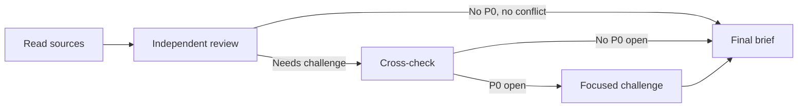

# Debate

## Installation

If a required CLI or runtime is missing, read [installation and verification](references/installation.md).


Run a bounded design review between CLI harnesses. The aim is to find material design faults and reach the execution boundary with the least process needed.

The moderator invokes the harnesses, keeps a lossless decision ledger, and writes the final review brief. The moderator and harnesses are read-only. They do not edit code or specs.

## Harness dependency

Before invoking any CLI, read [0-harness](../0-harness). It is the source of truth for current `codex`, `claude`, and `agy` non-interactive commands, permission flags, output capture, and failure handling.

This skill defines the debate protocol only. Apply these stricter rules on top of the shared harness guidance:

- use its read-only command for every turn;
- use one fresh process per harness and round;
- write each prompt, final response, and diagnostic log to a unique round-specific file;
- treat Agy read-only behavior as prompt-enforced and record that weaker guarantee;
- if any selected harness fails, report the error and stop rather than continuing as a one-agent debate.

## Inputs

- **goal**: the exact design question. Ask one short question only when the scope is unclear.
- **harnesses**: default to `codex` and `claude`. Add or replace with `agy` when requested.
- **sources**: specs, code, tickets, or other user-named paths. Point harnesses to the original files. Do not replace accessible sources with a moderator summary.

## Core rules

1. Prefer the smallest safe design.
2. Debate gaps and conflicts, not prose already settled by the source.
3. Keep design invariants separate from implementation choices.
4. Preserve every condition and qualifier when compacting.
5. Stop when implementation can start safely. Do not seek perfect agreement.



## Setup

Create a scratch directory such as `<scratchpad>/debate-<slug>/`. Store prompts, final agent messages, and diagnostic logs there.

Before round 1, inspect the named sources enough to define a short internal **source baseline**:

- explicit requirements and invariants;
- behavior already decided by the source;
- questions explicitly named by the goal;
- declared out-of-scope boundaries.

The baseline is an extractive index, not a moderator interpretation or a substitute for source reading. Cite file paths and lines when available. Keep it internal during round 1 so it cannot anchor the independent reviews. A source statement is not a debate decision unless the goal explicitly asks to change it.

## Run one turn

Write the debate prompt to a round-specific file. Invoke each selected CLI with the read-only pattern from `0-harness`.

Use this artifact naming convention:

```text
round-<n>-<harness>-prompt.md
round-<n>-<harness>-result.md
round-<n>-<harness>.log
```

For Codex, map `--output-last-message` to the result file. For Claude and Agy, map stdout to the result file and stderr to the log. Read only the final response on success. Inspect the diagnostic log only on failure.

## Prompt contract

Every prompt must contain:

1. The goal, verbatim.
2. Paths to original sources. Round 1 agents read them without the moderator baseline.
3. The current decision ledger from round 2 onward.
4. The peer material required by the round protocol.
5. A reminder to read relevant code paths before making code claims.
6. A discussion-only rule: no edits and no commands except source inspection.
7. A limit of 800 words.

Tell each harness:

- Report only a contradiction, missing decision, unsafe behavior, or simpler supported option.
- Do not restate the spec as a finding.
- Do not promote helper shape, query routing, timeout tuning, extra checks, or defensive branches into a design decision unless they meet the P0 test.
- A proposal that adds a component, state, read path, or branch must name the concrete failure it prevents, cite evidence, and explain why a smaller design fails.
- If evidence needs execution or a benchmark, define a falsifiable experiment instead of arguing from theory.
- If the ledger changes the meaning of a peer proposal, report `LEDGER_ERROR` with the exact correction before discussing decisions.

End each response with:

```text
---
CRITICAL_ISSUES: none | <short list of evidence-backed P0 issues>
DECISIONS:
- D-N.vM: ACCEPT | OBJECT — <one-sentence reason>
LEDGER_ERROR: n/a | none | <exact missing or changed condition>
---
```

In round 1, decision IDs are local labels and `LEDGER_ERROR` is `n/a`. The moderator maps local IDs to canonical IDs after reading every response. From round 2 onward, agents must use the ledger IDs exactly.

Do not use an agreement score. It adds process but cannot prove that agents accept the same proposition.

## Round protocol

### Round 1: independent review

Give every harness the same goal and source paths. Do not show the moderator baseline or peer output.

Ask for:

- at most three material findings;
- the source evidence for each finding;
- the smallest safe direction;
- only genuine design alternatives as decision candidates.

Run harnesses independently. Parallel execution is fine.

### Reconcile into a lossless ledger

Build one canonical ledger after round 1. Use stable IDs only for decisions that have competing choices or need explicit agreement.

```text
SOURCE FACTS
- F-1: <exact source behavior> — <citation>

DECIDED
- D-1.v1 [P1]: <shared non-blocking design choice, including conditions> — <evidence>

TENTATIVE
- D-2.v1 [P0]: <exact proposition independently supported by all harnesses; pending cross-check> — <evidence>

OPEN
- D-3.v1 [P0]: <exact option and conditions> — proposed by <harness>; <evidence>
- D-3.v2 [P0]: <exact competing option and conditions> — proposed by <harness>; <evidence>

NOTES
- N-1 [P1]: <implementation guidance>

EXPERIMENTS
- E-1: <falsifiable check and result that changes a decision>
```

Apply these rules:

- Copy the proposition's meaning. Never remove words such as `only`, `unless`, `same attempt`, or `different attempt`.
- Attach source evidence to the fact or proposal it supports.
- Compare the ledger against every raw round-1 response before using it.
- Put behavior already fixed by the source under `SOURCE FACTS`, not `OPEN` or `DECIDED`.
- Merge duplicate findings. Confirmation from two agents is one fact, not two decisions.
- Put implementation detail under `NOTES` unless it passes the P0 test.
- If the moderator cannot state a proposal without ambiguity, quote the smallest exact clause needed and keep it open.
- Put a matching P0 proposal under `TENTATIVE` until peers test it in round 2. This guards against a shared blind spot.

Stop after round 1 when there is no source contradiction, no open or tentative P0, and no competing design direction. Differences limited to P1/P2 notes do not justify another round. Otherwise run round 2.

### Round 2: independent cross-check

Give each harness:

- the same frozen ledger, including source facts derived from the internal baseline and round-1 evidence;
- every other harness's round-1 response;
- only open or tentative P0 decisions to assess.

Ask it to check the ledger first, then challenge the evidence and the smallest safe direction. Do not ask it to review settled P1/P2 notes.

After all responses:

1. Apply every valid `LEDGER_ERROR` before judging consensus.
2. Re-check corrected entries against the raw response.
3. Mark a decision decided only when all harnesses accept the same version with the same conditions.
4. Move non-blocking concerns to notes or experiments.
5. Stop when no P0 remains open or tentative.

Two rounds are the normal end state.

### Round 3: focused blocker only

Run one final sequential round only when round 2 leaves an evidence-backed P0 open. The prompt contains only:

- that P0's exact options and conditions;
- evidence for each option;
- the latest objection;
- the specific fact needed to resolve it.

Do not run round 3 for classification, wording, implementation detail, or a restatement of the source. Stop after round 3 as `READY` or `BLOCKED`. More rounds require an explicit user request.

## Priority and complexity tests

### P0 test

A point is P0 only when leaving it unresolved directly risks:

- durable data loss, corruption, or invalid duplication;
- an ownership, authorization, or trust-boundary violation;
- an invalid database or state invariant;
- a broken external API or required downstream contract;

and no conservative implementation default can defer it safely.

Every P0 must state the invariant, concrete failure, evidence, and why implementation cannot start safely. Track the invariant as P0, not every mechanism that may enforce it.

### Simplicity test

Prefer the option with fewer components, states, branches, and consistency domains when it satisfies all P0 invariants.

Reject added complexity when its support is only:

- a hypothetical edge case without repository evidence;
- a possible optimization without measurements;
- a defensive variant of an already safe path;
- finer read routing, caching, locking, or state splitting without a proven need.

Record useful delivery detail as a note. Drop detail that is neither actionable nor supported.

## Reopening decisions

A decided point may reopen only when:

1. new material evidence contradicts an accepted condition; or
2. a later decision invalidates one of its stated dependencies.

Create a new version and record the exact reason. A paraphrase, priority dispute, or alternative helper design is not enough.

## Final review brief

Keep the brief short. It is a synthesis, not a transcript.

### Required structure

```text
# Debate result: <goal>
STATUS: READY | BLOCKED — <plain reason>

## Verdict
- <chosen direction>
- <main trade-off or blocker>
- <next step>

## Decision map
<small Mermaid flowchart>

## New findings
| ID | Priority | Finding | Evidence | Impact |

## Decisions
| ID | Priority | Decision | Why |

## Open decisions
| ID | Priority | Options | What resolves it |

## Implementation notes
- N-1: <concrete non-blocking guidance>

## Execution checklist
- [ ] X-1 (P0) <next action>

Debate record: <harnesses>; <round count>; <stop reason>; <critical issues or none>; transcripts: <path>.
```

Rules:

- A tentative P0 counts as open. `READY` means no P0 remains open or tentative. `BLOCKED` means at least one P0 remains open or tentative.
- Use `G-N` IDs for new findings so they cannot be confused with decisions.
- Omit empty optional sections: New findings, Decisions, Open decisions, and Implementation notes.
- Include a fact from the source only when needed to explain a new finding or decision.
- Do not list paraphrased source content as debate value.
- Keep each table cell to one sentence.
- Use one small Mermaid diagram with at most eight decision nodes. Split it if needed.
- Do not include raw transcripts, tool logs, agent narration, or agreement scores.
- The debate record is the only place for process metadata.

## Guardrails

- Never edit code or specs during the debate.
- Never inspect diagnostic logs unless a harness command fails.
- Never let a compacted ledger override a raw response. Correct the ledger first.
- Never continue a debate only to settle P1/P2 concerns.
- Never claim consensus when agents accepted propositions with different conditions.
- Keep out-of-scope expansion out of the decision set unless the goal asks to change the boundary.
