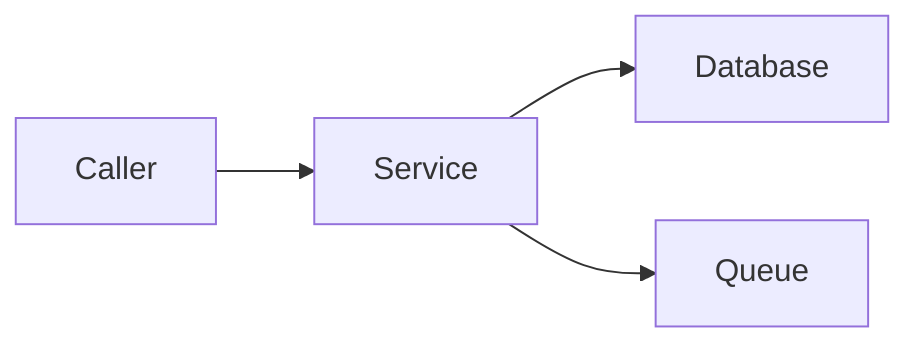

# Release Handoff Draft

Create a short runbook that tells DevOps what changed, what to do, in what
order, and how to check the result. Focus on this release. The deliverable
is a local Markdown draft for review and execution by DevOps. No publishing
platform, space, folder, or external document tool is required. This skill
does not publish documents or execute deployment steps.

## Inputs

- **Repository** — use the current repo or the one the developer specifies;
  ask if unclear.
- **Release reference** — developer-supplied tag, release URL, commit, or
  comparison range. Never substitute the latest release. Resolve the exact
  version and comparison baseline before making release-specific claims.
- **Migration** — developer supplies migration PRs, scripts, or instructions,
  or confirms no migration is needed. No fixed repository name is required.
- **Environment changes** — developer supplies additions, updates, removals,
  or confirms no changes. Use secret references instead of secret values.
- **Document owner and target environment** — use supplied values. Include
  contributors, approval, informed, linked ticket, and deployment date only
  when supplied or required by the team; never invent them.
- **Output path** — follow the developer's requested Markdown path or the
  repository convention. Otherwise use `./docs/<repo>-deploy-<timestamp>.md`
  (`YYYYMMDD-HHMMSS`).

## Workflow

1. **Inspect the supplied release.** Read available release notes and resolve
   the release reference to its commit or range. Use an explicit comparison
   baseline when supplied; otherwise use the relevant previous release in
   the same release line. Summarize the notes and verify deployment impact
   against the release changes. If notes are missing, brief the comparison.
   Link the release and comparison used. If the reference or baseline is
   unclear, ask and mark dependent findings unresolved until confirmed.
2. **Identify rollout services.** Inspect the repo at the release revision,
   including changed code, shared packages, build workflows, image builds,
   and deployment manifests/configuration. Map changes to deployable services,
   workers, or jobs. Check build/deploy triggers: a shared image or pipeline
   can require rolling out several services. Verify the target artifact or
   image version; it may differ from the Git tag. Do not use the current
   branch as evidence for a different release revision. If mapping is
   unresolved, record the gap rather than guessing the rollout list.
3. **Collect missing inputs together.** Ask only for information that is
   still missing after inspection. Inspect supplied migration sources and env
   changes for ordering or compatibility requirements. Flag conflicts with the release instead
   of silently adding or changing developer instructions. Missing input is
   not evidence that migration or env changes are unnecessary. Missing
   details do not block saving a draft; mark them as TBD and list what must
   be confirmed before DevOps can execute the affected steps.
4. **Draft with the template below.** Keep the metadata table first and
   sections 1 and 2 in the given order. Include rollback when useful and
   supported. Use `None` for confirmed no migration/env change; use
   `TBD — [missing input]` for unresolved facts. Include open items when
   anything remains unresolved. Keep status `DRAFT`.
5. **Save and hand off.** Save the Markdown file and return its path with a
   short list of unresolved items, if any. Read an existing draft before updating it,
   revise that same file when changes are requested, and retain it as the
   deliverable.

## Writing rules

- Use short English sentences unless the developer requests another language.
  Release notes should be a few bullets about changes DevOps needs to know.
- Every technical fact must come from the release revision, release or migration
  evidence, deployment configuration, or developer input. Never invent commands,
  domains, service names, image tags, or env values.
- Architecture is one overview layer, depth = 1: show the deployed service(s)
  and their direct callers/dependencies. Use a small Mermaid diagram with
  no internal modules, nested subgraphs, or request sequence details.
- State the execution order supported by migration compatibility and deployment
  configuration. The template groups migration, env changes, and rollout;
  reorder or split steps when evidence requires it. Give DevOps
  the actual job, pipeline, or command and a short success check for each
  applicable step. If unavailable, mark it TBD and request the missing detail.
- List only env changes for this release, with affected service, action,
  value or secret reference, and when to apply them.
- Include APIs, ports, resource limits, prerequisites, or dependency details
  only when they change or directly affect an action in this release. Avoid
  full inventories and unrelated setup instructions.
- If rollback is included, identify the previous release in the same release
  line and verify each service's rollback artifact. A preceding Git tag does
  not prove what is currently deployed; confirm the deployed version when
  it determines the rollback target. State any required env restoration or
  migration compatibility constraint. Do not assume reversing a DB migration
  is safe; leave unverified rollback steps unresolved.

## Template

Replace bracketed guidance with verified content. Remove optional metadata
rows and optional sections when unused. Keep migration and env sections even
when `None`. Renumber sections after removing or reordering them.
The architecture below illustrates one layer; adapt it to the actual repo.

````markdown
| Metadata | Value |
| --- | --- |
| Document Owner | [developer-provided owner] |
| Repository | [repository link or local path] |
| Environment | [target environment] |
| Status | DRAFT |
| Last updated | [YYYY-MM-DD] |
| Linked ticket | [optional link] |
| Deployment date | [optional developer-provided date] |

## 1. Overview

### 1.1. Release

[release reference and source link/path] · [comparison link or commit range]

### 1.2. Release notes

- [Main change and its deployment impact.]
- [Any required coordination or compatibility constraint.]

### 1.3. Architecture



## 2. Deployment

### 2.1. Migration

[None — confirmed by developer; otherwise:]

1. Run [migration source link/path] via [verified job/command and execution order].
2. Check [expected result].

### 2.2. Update Env

[None — confirmed by developer; otherwise:]

| Service | Action | Variable | Value / secret reference |
| --- | --- | --- | --- |
| [service] | [Add / Update / Remove] | [KEY] | [value / reference / —] |

Apply through [verified configuration location/job] at [verified execution point].
Check [expected configuration result without exposing secrets].

### 2.3. Roll out services

[Execute rows in order; note parallel rollout only if supported.]

| Step | Service | Target version / image | Rollout action | Success check |
| --- | --- | --- | --- | --- |
| 1 | [service] | [verified artifact] | [pipeline/job/command] | [health/job result] |

## 3. Rollback

1. Roll back [affected services] to [previous release link and verified
   artifact per service] using [verified pipeline/job/command].
2. [Restore changed env only if required; state migration compatibility
   constraints and any separately approved DB recovery procedure.]
3. Check [service health or job result].

## 4. Open items

[Include only unresolved facts or decisions that affect this handoff.]

| Missing detail | Affected step / impact | Who confirms |
| --- | --- | --- |
| [TBD detail] | [what cannot proceed until confirmed] | [supplied owner or TBD] |
````

